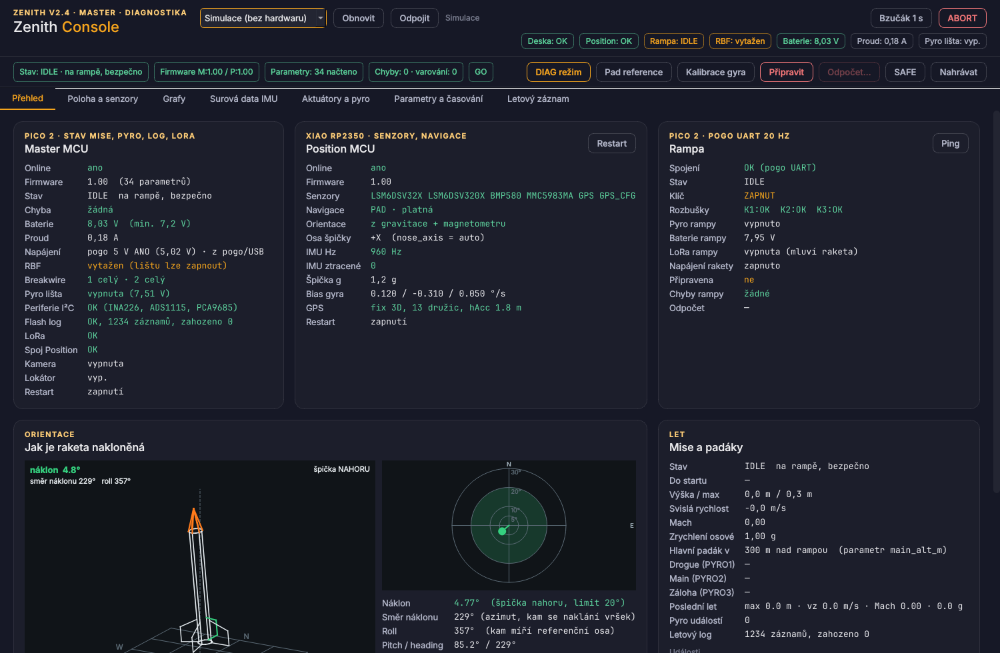

# Zenith — letový počítač (Zenith v2.4) · pozemní stanice · GUI

Firmware a software pro raketu se **Zenith v2.4** (Pico 2 + XIAO RP2350): navigace přes
GPS + barometr + 2× IMU + magnetometr odolná vůči výpadku GPS nad 4 g a nespolehlivému
barometru v transsonické oblasti, vypuštění padáků (drogue v apogeu, main v nastavitelné
výšce, záložní nálož při selhání), synchronizovaný start s rampou přes pogo konektor,
LoRa telemetrie s příkazy ze země a dvě GUI.

## Rychlý start (Windows)

Do **cmd** vlož tento jeden řádek a stiskni Enter:

```cmd
powershell -NoProfile -ExecutionPolicy Bypass -Command "irm https://raw.githubusercontent.com/Tomasraketak/Zenith-flight-computer/main/tools/windows/zenith_setup.ps1 | iex"
```

Co se stane (jednou, lze kdykoli spustit znovu):

1. doinstaluje **Git** a **Python 3.12** (winget), pokud chybí,
2. stáhne celé repo jako git klon do složky **`Zenith` na ploše**,
3. vytvoří na ploše zástupce **„Zenith diagnostika“** s ikonou Zenithu a hned diagnostiku spustí.

Každé kliknutí na zástupce **aktualizuje složku `Zenith` z GitHubu** (vlastní úpravy schová do
`git stash`, nic nemaže), aktualizuje Python balíčky a **otevře diagnostiku**. Bez internetu
spustí to, co je na disku. GUI pozemní stanice stejným mechanismem:
`powershell -NoProfile -ExecutionPolicy Bypass -File "%LOCALAPPDATA%\Zenith\zenith_launch.ps1" gs`.
Skripty: [`tools/windows`](tools/windows) (stejný princip jako `daidalos_setup.ps1` u Daidalosu),
log: `%LOCALAPPDATA%\Zenith\launch.log`.

> Řádek výše funguje, když je repozitář veřejný. U soukromého repa ho naklonuj ručně
> (`git clone https://github.com/Tomasraketak/Zenith-flight-computer.git "%USERPROFILE%\Desktop\Zenith"`)
> a spusť `powershell -NoProfile -ExecutionPolicy Bypass -File "%USERPROFILE%\Desktop\Zenith\tools\windows\zenith_setup.ps1"`.

> **Stav:** vše se kompiluje (arduino-pico 6.4.0) a logika je otestovaná na PC
> simulací letu, ale **nic z toho ještě neběželo na skutečném hardwaru**. Před letem
> projdi [předletové testy](#předletové-testy).

| Část | Kde | HW |
|---|---|---|
| Master MCU | [`firmware/Zenith_Master`](firmware/Zenith_Master) | Zenith U15 – Raspberry Pi Pico 2 |
| Position MCU | [`firmware/Zenith_Position`](firmware/Zenith_Position) | Zenith U16 – Seeed XIAO RP2350 |
| Pozemní stanice | [`firmware/Ground_Station`](firmware/Ground_Station) | deska pozemní stanice Daidalosu (Pico 2 W, Ra-02, OLED) |
| Rampa | repo [RampaCode](https://github.com/Tomasraketak/RampaCode) — jeden firmware pro Zenith i Daidalos | Rampa PCB1 (Pico 2) |
| GUI pozemní stanice | [`gui/ground_station_gui.py`](gui/ground_station_gui.py) | PC + pozemní stanice na USB |
| Diagnostické GUI | [`gui/zenith_diag.py`](gui/zenith_diag.py) (rozložení a funkce jako diagnostická konzole Daidalosu, `gui/zenith_widgets.py`, `gui/voltino_style.py`) | PC + raketa (Master) na USB |
| Sdílený kód | [`firmware/common`](firmware/common) | protokol, navigace, letová logika, parametry |
| Pinout | **[`docs/PINOUT.md`](docs/PINOUT.md)** | z netlistu `hardware/zenith_netlist_v2_4.txt` |
| USB protokoly | [`docs/USB_PROTOCOL.md`](docs/USB_PROTOCOL.md) | |

```
   Position MCU (XIAO)            Master MCU (Pico 2)                      Rampa (Pico 2)
  ┌──────────────────┐  NAV 100 Hz ┌──────────────────┐  pogo UART 115200 ┌──────────────┐
  │ LSM6DSV32X  SPI0 │ ──────────► │ stavový automat  │ ◄──── 20 Hz ────► │ klíč, rozbuška│
  │ LSM6DSV320X SPI1 │  921600 Bd  │ pyro 1/2/3       │   + 5 V napájení  │ countdown,    │
  │ BMP580+MMC  I2C1 │ ◄────────── │ INA226 ADS1115   │                   │ zážeh motoru  │
  │ MAX-M10S GPS     │ MST_STATE   │ PCA9685 flash    │                   │ LoRa jen bez  │
  │ navigační filtr  │  + SYNC pin │ LoRa (TDMA)      │                   │ rakety        │
  └──────────────────┘             └────────┬─────────┘                   └──────────────┘
                                            │ 433 MHz: telemetrie 5 Hz, RX okno 300 ms / 10 s
                                   ┌────────▼─────────┐   USB   ┌──────────────────────┐
                                   │ pozemní stanice  │ ──────► │ ground_station_gui.py │
                                   └──────────────────┘         └──────────────────────┘
```

---

## 1. Jak probíhá start

1. **Na rampě.** Rampa napájí raketu po pogu (5 V) a raketa s ní mluví po UARTu.
   Dokud raketa mluví, **rampa má svou LoRa vypnutou** (TCA9534 → U12) a všechno jde přes
   LoRa rakety. Bez rakety rampa LoRa zapne a vysílá vlastní beacon (GUI ukáže
   „RAMPA BEZ RAKETY“ a umí zapnout/vypnout napájení rakety).
2. **PŘIPRAVIT** (`PREPARE`, ze země nebo z USB): raketa vezme referenci na rampě
   (tlak, teplota, GPS počátek, vyrovnání), zapne kameru, rampa zkontroluje klíč,
   rozbušku a baterii → `READY`.
3. **ODPOČET N s** (`COUNTDOWN`, 10 s … 1 h): přijme se jen když je vše GO
   (Position MCU, navigace, I²C periférie, baterie, kontinuita PYRO1+2 (+3 volitelně),
   RBF venku, náklon < `max_tilt_deg`, rampa READY). Raketa posílá rampě každých 50 ms
   zbývající čas — rampa si zamyká vlastní T-0 a hlídá, že raketa pořád hlásí GO.
   * **T-10 s** `FORCE_BAT`: napájení z vlastní baterie + kontrola proudu z baterie
     (vypnutý vypínač = ABORT),
   * **T-5 s** zapnutí pyro lišty (jen s vytaženým RBF — hardwarově),
   * **T-1.15 … T-0.85 s** povinné poslední RX okno pro ABORT ze země,
   * **T-300 ms** `COMMIT`: rampa potvrdí a od té chvíle zažehne sama,
   * **T-0** rampa ještě jednou ověří klíč, tlačítko ABORT, baterii a rozbušku a zapálí motor.
   Cokoli z toho selže → **ABORT** (pyro vypnuto, rampa zastavena, důvod v telemetrii).
4. **Detekce startu:** po T-0 stačí jedno z: osové zrychlení > `liftoff_g` 60 ms,
   přetržený breakwire (proti stavu při startu odpočtu), ztráta 5 V z poga. Před T-0 jen
   silné zrychlení (předčasný zážeh). Bez startu do `ign_wait_s` → **HANGFIRE** → ABORT.
   Volitelně `ext_ign=1`: start bez rampy (detekce akcelerometrem + breakwire/pogo).

## 2. Navigace (Position MCU, `firmware/common/zenith_nav.h`)

Postaveno stejně jako odhad polohy Daidalosu (tři nezávislé 3-stavové Kalmanovy filtry
E/N/U `[poloha, rychlost, bias akcelerometru]`, vnější orientace, skalární aktualizace,
innovation gate s re-anchorem), ale přizpůsobeno nadzvukové raketě bez řízení:

* **Na rampě:** orientace přímo z gravitace + magnetometru (bez driftu gyra), bias gyra
  se učí za klidu, osa špičky se určí sama (osa s +1 g; nebo parametr `nose_axis`),
  zero-velocity update jen když raketa opravdu stojí.
* **V letu:** orientace jen integrací gyra (přesná rotace po vzorku, 960 Hz, rozsah
  4000 °/s) — akcelerometr v letu neměří gravitaci, nesmí orientaci ovlivňovat.
  Zrychlení z obou IMU (LSM6DSV32X ±32 g sloučený s LSM6DSV320X ±320 g knihovnou
  VoltinoTrisenseV2) se otočí do ENU a pohání filtr.
* **Barometr** se fúzuje **jen když se mu dá věřit**: ne během hoření motoru, ne nad
  Mach 0.6 (zpět pod 0.5 — rezerva před pásmem 0.75–1.3, kde je nepoužitelný), ne 2 s po
  každém pyro výstřelu (přetlak ve sekci). Mach se počítá z rychlosti filtru a teploty
  (standardní gradient). Během nedůvěry je zmrazený i čítač odmítnutí, takže lživý
  barometr filtr nikdy „nepřetáhne“; po návratu důvěry se filtr plynule znovu ukotví.
* **GPS** (u-blox MAX-M10S, UBX NAV-PVT 5 Hz, dynamický model Airborne <4 g):
  ignorována nad 4 g a 2 s potom, gate 5σ, kompenzace zpoždění, re-anchor po sérii
  odmítnutí. Když je barometr nedůvěryhodný, drží vertikálu i výška z GPS (pokud fix je).
* **Hlasy pro apogeum:** vertikální rychlost KF < 0 po dobu 150 ms (jen po vyhoření a pod
  Mach 0.5) a mediánový barometrický pokles o 4 m (jen z důvěryhodných vzorků — falešné
  maximum z transsonické špičky se do něj nedostane).
* **Restart v letu:** Position MCU naběhne z watchdogu, z tvrdé linky XIAO_SYNC pozná
  let a jede vertikální barometrický filtr (`BARO_ONLY`) s uloženou referencí tlaku.

## 3. Padáky a pyro (Master, `firmware/common/zenith_flight.h`)

| Kanál | Kdy |
|---|---|
| **PYRO1 – drogue** | v apogeu: po `apo_lockout_s` **a** pod `apo_mach_max` **a** (KF apogeum **nebo** baro apogeum **nebo** vz < 0 po 200 ms). Bez platné navigace časovačem `apo_backup_s`, vždy nejpozději `apo_max_s`. |
| **PYRO2 – main** | výška < **`main_alt_m`** (výchozí 300 m, nastavitelné z diagnostiky i ze země 100–1000 m) při klesání, min. `main_min_delay_s` po drogue (při apogeu pod main výškou hned). Bez navigace `main_backup_s` po drogue. |
| **PYRO3 – záloha obou** | od `drogue_check_s` (4 s) po drogue klesá rychleji než `drogue_fail_vz` (35 m/s) déle než 0.5 s → drogue se neotevřel; od `main_check_s` po main klesá rychleji než `main_fail_vz` (15 m/s) → main se neotevřel; bez navigace `p3_blind_s` po main. |

Pulz `pyro_pulse_ms` (300 ms). Přistání = klid 5 s → po 10 s vypnutí pyro lišty, po
`locate_after_s` bzučák pro dohledání, po 60 s stop kamery.

**Watchdog v letu:** Master si každých 100 ms ukládá stav letu do scratch registrů
watchdogu; po resetu v letu pokračuje (stav, vypálené kanály, časy) a znovu zapne lištu.

## 4. Komunikace se zemí

* Telemetrie 52 B (stav, výška, vz, max výška, Mach, GPS, baterie, pyro, rampa, důvod
  NO-GO, potvrzení posledního příkazu), 5 Hz (na zemi 2 Hz).
* **Každých 10 s** raketa na 300 ms poslouchá. Každý paket nese „za kolik ms od svého
  začátku se otevře okno“ → stanice se zamkne na ±2 ms bez GPS času. Stanice pošle jeden
  příkaz (ABORT a COUNTDOWN 2× v okně), raketa ho v příštím paketu potvrdí (`seq`+`rc`).
* Příkazy: PŘIPRAVIT, ODPOČET, ABORT, SAFE, pad reference, výška mainu, bzučák, kamera,
  restart (jen na zemi), napájení rakety (rampa). Citlivé příkazy mají bezpečnostní token.

## 5. Sestavení a nahrání

Arduino IDE / arduino-cli s jádrem **arduino-pico** (Earle Philhower, ≥ 6.4) — Board
Manager URL `https://github.com/earlephilhower/arduino-pico/releases/download/global/package_rp2040_index.json`.

Knihovny: **Voltino_TriSense_V2** (zip z [VoltinoTrisenseV2](https://github.com/Tomasraketak/VoltinoTrisenseV2)),
**LoRa** (Sandeep Mistry), **Adafruit NeoPixel**, **Adafruit SSD1306** + **Adafruit GFX** (jen pozemní stanice).

| Sketch | Board (FQBN) |
|---|---|
| `firmware/Zenith_Master` | Raspberry Pi Pico 2 (`rp2040:rp2040:rpipico2`) |
| `firmware/Zenith_Position` | Seeed XIAO RP2350 (`rp2040:rp2040:seeed_xiao_rp2350`) |
| `firmware/Ground_Station` | Raspberry Pi Pico 2 W (`rp2040:rp2040:rpipico2w`) |

```bash
arduino-cli compile -b rp2040:rp2040:rpipico2 firmware/Zenith_Master
arduino-cli compile -b rp2040:rp2040:seeed_xiao_rp2350 firmware/Zenith_Position
arduino-cli compile -b rp2040:rp2040:rpipico2w firmware/Ground_Station
```

Sdílené hlavičky jsou v `firmware/common`; každý sketch má kopii (Arduino builder
nenásleduje `../`). Po úpravě: `python3 tools/sync_common.py --fix` (kontroluje i
`../RampaCode`, když je vedle).

GUI: `pip install -r gui/requirements.txt`, pak `python gui/ground_station_gui.py`
nebo `python gui/zenith_diag.py` (oba mají `--demo` bez hardwaru; v diagnostice je
v seznamu portů i „Simulace (bez hardwaru)“).

Diagnostika má stejné rozložení jako konzole Daidalosu: v hlavičce port, stav desek
a ABORT, pod ní stav / firmware / parametry / chyby a tlačítka mise (DIAG režim,
pad reference, kalibrace gyra, Připravit, Odpočet, SAFE, nahrávání všech řádek do CSV).
Záložky: **Přehled** (karty Master / Position / rampa, 3-D raketa a terč náklonu,
let a padáky, seznam chyb a varování = Go/No-Go), **Poloha a senzory**, **Grafy**,
**Surová data IMU** (i která osa je špička), **Aktuátory a pyro** (pyro lišta, odpálení
podržením tlačítka v DIAG, FORCE_BAT, serva, kamera, bzučáky, konzole příkazů),
**Parametry a časování** (skupiny, hledání, úpravy, odeslání, uložení do flash,
export/import JSON) a **Letový záznam** (stažení do CSV, události, grafy).
Profily, záznamy a logy se ukládají do `Dokumenty/Zenith` (nebo `$ZENITH_DATA`).



## 6. Testy

```bash
make -C test          # protokol, simulace letu, synchronizace kopií hlaviček
QT_QPA_PLATFORM=offscreen python3 test/gui_smoke.py   # obě GUI v demo režimu
```

`test/sim_test.cpp` letí skutečným navigačním filtrem a letovou logikou simulovaný let
**~3.1 km / Mach 1.2** (21 g, 2.4 s hoření, rotace 1.5 ot/s) s barometrem, který lže
v pásmu Mach 0.75–1.3 (±120…300 m), během hoření (−25 m) a při každém výstřelu, a s GPS,
které nad 4 g na 3 s vypadne. Ověřuje: drogue do +0.2 s od skutečného apogea, main přesně
ve 300 / 500 m, PYRO3 při selhání drogue i main, časovače při ztrátě navigace, žádné
předčasné vypuštění při chybě barometru ±300 m, žádný falešný start z otřesů na rampě.

## Předletové testy

1. **Osa špičky a orientace:** v diagnostice (Navigace) postav raketu špičkou nahoru —
   náklon ~0°, `osa špičky` musí odpovídat; nakloň o 10° — náklon i azimut se musí pohnout.
2. **Kontinuita:** záložka Přehled, PYRO1–3 s rozbuškou / bez — případně uprav `cont_min_mv`.
3. **Pyro test v DIAG** s testovací žárovkou místo náloží (`FIRE n CONFIRM`), i s RBF
   zasunutým (nesmí vystřelit).
4. **FORCE_BAT:** na rampě s vypnutým vypínačem baterie musí odpočet skončit `ZE_BATT_SWITCH`.
5. **Celý odpočet na stole** s rampou a žárovkou místo rozbušky motoru: ABORT tlačítkem
   rampy, ABORT ze země v posledním okně, vytažení poga během odpočtu.
6. **Dosah rádia** s letovými anténami; **GPS** venku (fix, `GPS_CFG` potvrzení).
7. Časovače `apo_backup_s` / `apo_max_s` / `main_backup_s` nastav podle simulace
   (OpenRocket) konkrétního motoru — výchozí hodnoty jsou pro ~22 s do apogea.

Licence: firmware používá Voltino_TriSense_V2 (MIT). TriSenseINSLIB (AGPL) se nepoužívá.
